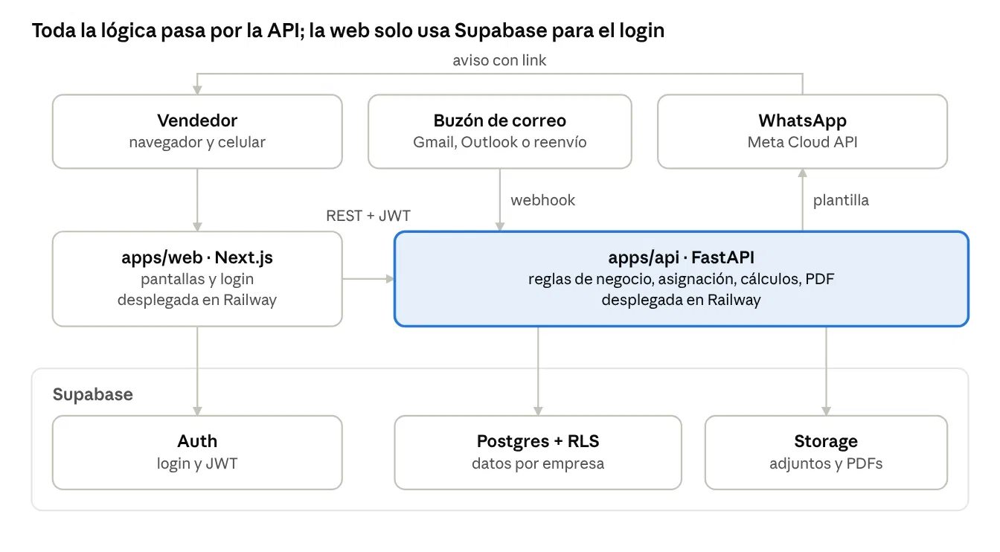
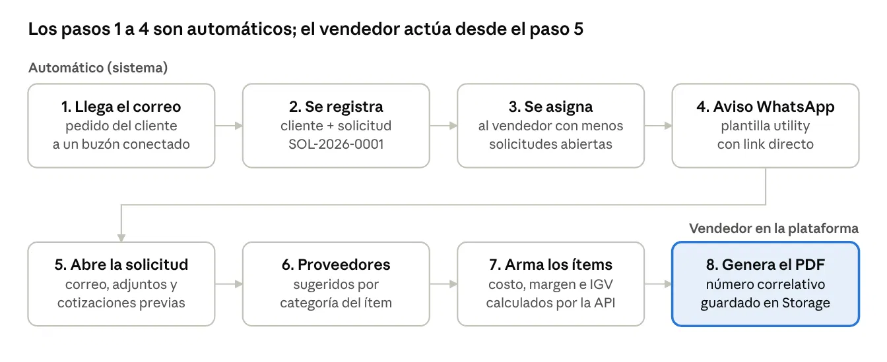
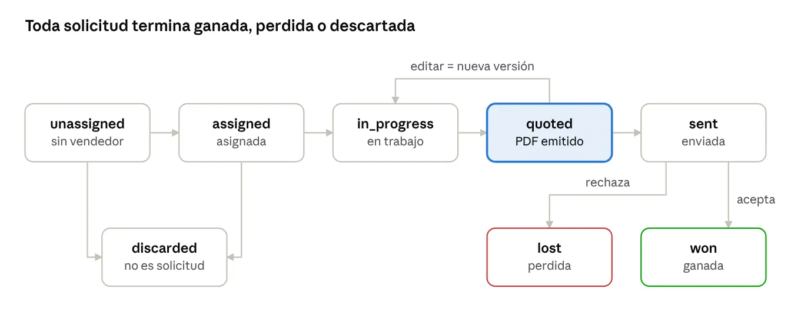

# Arquitectura

CotizAPP es un **monorepo con dos apps**: una API en Python (`apps/api`, FastAPI) desplegada en **Railway**, y una web en Next.js (`apps/web`) desplegada en **Vercel**. La base de datos, el login y los archivos viven en **Supabase**. Detalle en [despliegue.md](despliegue.md).

## Idea principal

**Toda la lógica pasa por la API; la web solo usa Supabase para el login.**



> La imagen dice que `apps/web` se despliega en Railway. Para la demo se despliega en **Vercel**; el resto del diagrama no cambia.

| Pieza | Qué hace | Con quién habla |
|---|---|---|
| Vendedor | Usa la plataforma desde el navegador o el celular | `apps/web`; recibe el WhatsApp |
| Buzón de correo (Gmail, Outlook o reenvío) | Recibe los pedidos de los clientes | `apps/api` por webhook |
| `apps/web` · Next.js | Pantallas y login | Supabase Auth (login) y `apps/api` (REST + JWT) |
| `apps/api` · FastAPI | Reglas de negocio, asignación, cálculos y PDF | Postgres, Storage y WhatsApp |
| WhatsApp (Meta Cloud API) | Envía al vendedor el aviso con link | Recibe la plantilla desde `apps/api` |
| Supabase Auth | Login y JWT | |
| Supabase Postgres + RLS | Datos separados por empresa | |
| Supabase Storage | Adjuntos de los correos y PDFs emitidos | |

Un **JWT** es un texto firmado que Supabase entrega al iniciar sesión. La web lo envía en cada llamada a la API, y la API lo valida para saber quién es el usuario y de qué empresa es.

¿Por qué así?

- **Entrada de correo genérica:** el webhook recibe un correo en formato normalizado (`from`, `subject`, `text`, `html`, `message_id`, `attachments`). Conectar Gmail, Outlook o un buzón reenviado es solo escribir un adaptador.
- **Tipos compartidos generados:** FastAPI publica su OpenAPI y `packages/api-client` genera los tipos que usa la web. Si cambia un endpoint, la web no compila hasta adaptarse.
- **Migraciones en SQL con Supabase CLI, no Alembic:** las políticas RLS son SQL y deben vivir junto a las tablas. Los modelos SQLAlchemy de la API reflejan esas tablas.

## Multi-empresa

Varias empresas usan la misma plataforma. Cada una tiene sus vendedores, clientes, proveedores y plantilla de PDF.

- **Toda tabla de negocio lleva `organization_id`.**
- **Row Level Security (RLS):** reglas de PostgreSQL que filtran las filas según quién consulta. Un usuario solo ve filas de las empresas a las que pertenece.
- La API obtiene la empresa del usuario desde su sesión (JWT). **El frontend nunca la envía.**

## Actores

| Actor | Qué hace en la plataforma |
|---|---|
| Empresa (`organization`) | Nuestro cliente. Tiene vendedores, clientes, proveedores y su propia plantilla de PDF |
| Administrador (`admin`) | Configura la empresa: vendedores, proveedores, categorías, plantilla, datos fiscales |
| Vendedor (`seller`) | Recibe solicitudes asignadas, consulta proveedores, arma la cotización y genera el PDF |
| Cliente final (`customer`) | Envía el correo pidiendo cotización. No entra a la plataforma |
| Proveedor (`supplier`) | A quien el vendedor consulta precios. No entra a la plataforma en v1 |

## Reglas del producto

- **Los cálculos los hace el código.** Subtotal, IGV, total y margen se calculan en la API. La base de datos solo los guarda; la web solo los muestra.
- **El IGV sale de la empresa** (`organizations.tax_rate`, por defecto 0.18).
- **Dinero en `numeric(12,2)` y cantidades en `numeric(12,3)`. Nunca `float`.** En Python se usa `Decimal`. Con `float` aparecen errores como `149.99999`.
- **Una cotización emitida (`issued`) no se edita.** Para cambiarla se crea una nueva versión y la anterior pasa a `superseded`. Su PDF se guarda tal como se generó.
- **El costo y el margen nunca salen en el PDF.**
- **Numeración correlativa por empresa y año, sin huecos ni duplicados:** solicitudes `SOL-2026-0001` y cotizaciones `COT-2026-0001`, usando `quote_counters`.
- **Un correo nunca crea dos solicitudes:** `inbound_emails.message_id` es único.
- **Asignación automática:** entre vendedores con `is_available = true`, se elige al de menos solicitudes abiertas. En empate, al que recibió su última asignación hace más tiempo.

## Flujo de una solicitud

**Los pasos 1 a 4 son automáticos; el vendedor actúa desde el paso 5.**



## Estados de una solicitud

**Toda solicitud termina ganada, perdida o descartada.** El estado se guarda en `quote_requests.status`.



| Estado | Significado | Pasa a |
|---|---|---|
| `unassigned` | Sin vendedor | `assigned`, `discarded` |
| `assigned` | Asignada a un vendedor | `in_progress`, `discarded` |
| `in_progress` | El vendedor está trabajando en ella | `quoted` |
| `quoted` | PDF emitido | `sent`, o vuelve a `in_progress` si se edita (nueva versión) |
| `sent` | Cotización enviada al cliente | `won` si acepta, `lost` si rechaza |
| `won` | Ganada | — (final) |
| `lost` | Perdida | — (final) |
| `discarded` | El correo no era una solicitud | — (final) |

Una solicitud queda en `unassigned` cuando no hay vendedores disponibles; en ese caso se avisa al admin.

## Modelo de datos

PostgreSQL en Supabase, nombres en inglés.

| Concepto | Tabla | Definición |
|---|---|---|
| Solicitud | `quote_requests` | Un pedido de cotización recibido. Nace del correo y tiene un vendedor asignado |
| Correo entrante | `inbound_emails` | El correo original tal como llegó, con remitente, asunto, cuerpo y adjuntos |
| Cotización | `quotes` | El documento que responde a una solicitud. Una solicitud puede tener varias versiones |
| Ítem | `quote_items` | Una línea de la cotización: descripción, cantidad, unidad, costo, precio de venta |
| Consulta a proveedor | `supplier_inquiries` | Registro de que se consultó a un proveedor y qué respondió |
| Categoría | `categories` | Agrupa productos y proveedores. Permite sugerir a quién consultar |

### Relaciones principales

```
organizations 1 ── * members, customers, categories, suppliers, quote_requests
customers     1 ── * customer_contacts
inbound_emails 1 ── * email_attachments
quote_requests 1 ── * request_events, supplier_inquiries, quotes
quotes        1 ── * quote_items
suppliers     * ── * categories        (a través de supplier_categories)
```

### Tablas

| Tabla | Campos principales | Notas |
|---|---|---|
| `organizations` | id, name, tax_id, address, logo_path, quote_prefix, currency, tax_rate, inbound_alias | La empresa cliente. `tax_rate` por defecto 0.18 |
| `members` | id, organization_id, user_id, full_name, role, whatsapp_phone, is_available | `user_id` apunta a `auth.users`. `role`: `admin`, `seller` |
| `customers` | id, organization_id, tax_id, name, address | Único (`organization_id`, `tax_id`) |
| `customer_contacts` | id, customer_id, name, email, phone | El email permite reconocer al cliente cuando escribe |
| `inbound_emails` | id, organization_id, provider, message_id, from_email, from_name, subject, body_text, body_html, received_at | `message_id` único |
| `email_attachments` | id, inbound_email_id, filename, mime_type, size, storage_path | Archivos en Supabase Storage |
| `quote_requests` | id, organization_id, code, customer_id, contact_id, inbound_email_id, assigned_to, status, assigned_at, due_at | `code`: `SOL-2026-0001`. `assigned_to` → `members`. `status`: ver [Estados de una solicitud](#estados-de-una-solicitud) |
| `request_events` | id, request_id, type, actor_id, data, created_at | Historial: creada, asignada, notificada, cotizada… |
| `categories` | id, organization_id, name | Ej: tuberías, eléctricos, ferretería |
| `suppliers` | id, organization_id, name, tax_id, contact_name, email, phone | |
| `supplier_categories` | supplier_id, category_id | Qué vende cada proveedor: base de la sugerencia |
| `supplier_inquiries` | id, request_id, supplier_id, status, notes, answered_at | `status`: `pending`, `answered`, `no_response` |
| `quotes` | id, organization_id, request_id, number, version, currency, includes_tax, payment_terms, delivery_time, validity_days, notes, subtotal, tax, total, status, pdf_path, issued_at, created_by | `status`: `draft`, `issued`, `superseded` |
| `quote_items` | id, quote_id, position, description, quantity, unit, category_id, supplier_id, unit_cost, margin_pct, unit_price, line_total | El costo y el margen nunca salen en el PDF |
| `quote_counters` | organization_id, kind, year, last_value | Correlativos por empresa y año |
| `notifications` | id, organization_id, member_id, request_id, channel, status, provider_message_id, error, sent_at | Registro de cada aviso de WhatsApp |

**Cotizaciones previas del cliente** = `quotes` emitidas cuya solicitud tiene el mismo `customer_id`, las más recientes primero.

Las tablas se crean por partes, cada una en el ticket que la necesita (COT-02, COT-04, COT-08, COT-09).

## Estructura de carpetas

```
cotizador-online/
├── apps/
│   ├── api/              # FastAPI, gestionado con uv. Por ahora solo GET /health
│   └── web/               # Next.js 16 (App Router) + Tailwind + shadcn/ui
├── packages/
│   └── api-client/        # Tipos generados desde el OpenAPI de apps/api (vacío hasta que haya endpoints de negocio)
├── supabase/
│   └── migrations/        # Migraciones SQL vía Supabase CLI (vacío hasta tener credenciales)
├── specs/                  # spec.md, plan.md, tasks.md de cada feature
├── docs/                   # esta documentación
├── pnpm-workspace.yaml      # workspaces: apps/*, packages/*
├── turbo.json               # tareas dev/build de Turborepo
├── AGENTS.md
└── README.md
```

`.claude/skills/` todavía no existe — se crea cuando haya contenido real que documentar ahí.

`pnpm dev` (Turborepo) solo levanta `apps/web`: `apps/api` no tiene `package.json`, así que Turborepo no la ve. Por ahora la API se levanta aparte (ver [Cómo empezar](../README.md#cómo-empezar)).
