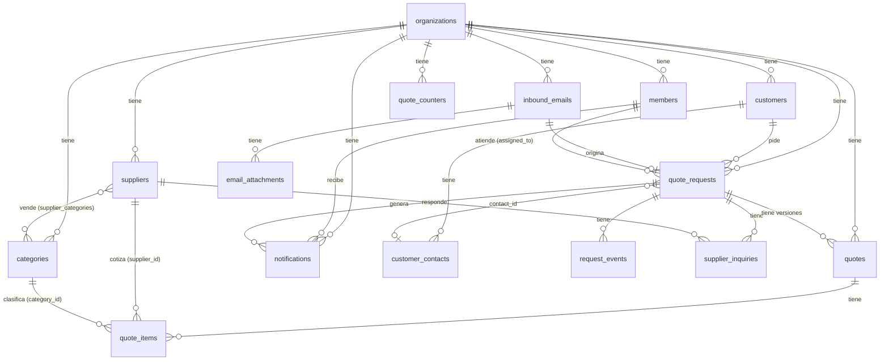

# Modelo de datos

Diseño completo de las 16 tablas del MVP, antes de crear ninguna migración. Punto de partida: [arquitectura.md](arquitectura.md#modelo-de-datos). Este documento no crea tablas — eso lo hacen COT-19, COT-22, COT-27 y COT-28, cada uno con su parte.

## Decisiones de diseño

Estas reglas aplican a **todas** las tablas, para no repetirlas en cada una.

| Decisión | Elegido | Por qué |
|---|---|---|
| Tipo de `id` | `uuid`, default `gen_random_uuid()` | `auth.users.id` de Supabase ya es `uuid`. Si mezclamos `bigint` en nuestras tablas y `uuid` en auth, cada FK a `members.user_id` necesita un tipo distinto. Un solo tipo en todo el esquema es más simple. |
| `created_at` / `updated_at` | `timestamptz not null default now()` | `updated_at` se actualiza con un trigger (`moddatetime` o uno propio), no a mano desde la API. |
| Dinero | `numeric(12,2)` | Nunca `float`. Hasta 9,999,999,999.99 — de sobra para una cotización. |
| Cantidades | `numeric(12,3)` | Permite cantidades como `2.5` o `10.250` (kg). |
| Estados | `enum` de Postgres | Más estricto que `text` + `check`: Postgres rechaza un valor fuera de la lista al nivel de tipo, no solo al insertar. |
| Organización de cada fila | `organization_id uuid not null references organizations(id)` en toda tabla de negocio directa; en las 6 tablas hijas, **no** se repite — se resuelve vía la tabla padre (ver [abajo](#tablas-sin-organization_id)) | Evita datos repetidos. La fila ya sabe a qué empresa pertenece a través de su padre. |

## Diagrama entidad-relación



> GitHub renderiza este bloque como imagen automáticamente. No hace falta exportar un PNG aparte.

## Estrategia de RLS

Una sola función auxiliar, reutilizada en la política de cada tabla:

```sql
create or replace function is_member(target_org uuid)
returns boolean
language sql
security definer
stable
as $$
  select exists (
    select 1 from members
    where members.organization_id = target_org
      and members.user_id = auth.uid()
  );
$$;
```

`security definer` + `stable` para que la función pueda leer `members` aunque la política de `members` también use RLS, y para que Postgres pueda cachear el resultado dentro de la misma consulta.

**Tablas con `organization_id` propio** (`organizations`, `members`, `customers`, `categories`, `suppliers`, `quote_requests`, `quotes`, `inbound_emails`, `quote_counters`, `notifications`):

```sql
create policy "select_own_org" on <tabla>
  for select using (is_member(organization_id));

create policy "write_own_org" on <tabla>
  for insert with check (is_member(organization_id));
```

(`update`/`delete` siguen el mismo patrón que `select`.)

### Tablas sin `organization_id`

Las 6 tablas hijas se resuelven con un `exists` contra el padre, en vez de repetir la columna:

| Tabla | Padre | Política (ejemplo `select`) |
|---|---|---|
| `customer_contacts` | `customers` | `exists (select 1 from customers c where c.id = customer_contacts.customer_id and is_member(c.organization_id))` |
| `email_attachments` | `inbound_emails` | `exists (select 1 from inbound_emails e where e.id = email_attachments.inbound_email_id and is_member(e.organization_id))` |
| `request_events` | `quote_requests` | `exists (select 1 from quote_requests r where r.id = request_events.request_id and is_member(r.organization_id))` |
| `supplier_inquiries` | `quote_requests` | `exists (select 1 from quote_requests r where r.id = supplier_inquiries.request_id and is_member(r.organization_id))` |
| `quote_items` | `quotes` | `exists (select 1 from quotes q where q.id = quote_items.quote_id and is_member(q.organization_id))` |
| `supplier_categories` | `suppliers` | `exists (select 1 from suppliers s where s.id = supplier_categories.supplier_id and is_member(s.organization_id))` |

**Por qué así y no agregando la columna:** son tablas puramente dependientes de un solo padre — nunca se consultan sin pasar por él. Agregar `organization_id` sería un dato redundante que puede desincronizarse si algún día se reasigna el padre.

## Numeración sin huecos ni duplicados

Una función que inserta o incrementa en una sola sentencia atómica — el `insert ... on conflict` bloquea la fila mientras dura la operación, así que dos solicitudes concurrentes nunca pueden recibir el mismo número:

```sql
create or replace function next_counter(p_organization_id uuid, p_kind text, p_year int)
returns int
language plpgsql
as $$
declare
  v_value int;
begin
  insert into quote_counters (organization_id, kind, year, last_value)
  values (p_organization_id, p_kind, p_year, 1)
  on conflict (organization_id, kind, year)
  do update set last_value = quote_counters.last_value + 1
  returning last_value into v_value;

  return v_value;
end;
$$;
```

Uso: `select next_counter(org_id, 'SOL', 2026)` → `1`, `2`, `3`... Se formatea en la API como `SOL-2026-0001` (el ancho del padding y el prefijo son responsabilidad de la API, no de la base de datos).

## Enums

```sql
create type member_role as enum ('admin', 'seller');

create type quote_request_status as enum (
  'unassigned', 'assigned', 'in_progress', 'quoted', 'sent', 'won', 'lost', 'discarded'
);

create type quote_status as enum ('draft', 'issued', 'superseded');

create type supplier_inquiry_status as enum ('pending', 'answered', 'no_response');
```

> `notifications.status` queda fuera de esta lista — ver [preguntas abiertas](#preguntas-abiertas).

## Tablas

Para cada tabla: columna, tipo, nulo, default, referencia y acción al borrar (`on delete`).

### `organizations`

| Columna | Tipo | Nulo | Default | Referencia |
|---|---|---|---|---|
| id | uuid | no | `gen_random_uuid()` | PK |
| name | text | no | | |
| tax_id | text | no | | único |
| address | text | sí | | |
| logo_path | text | sí | | ruta en Supabase Storage |
| quote_prefix | text | no | `'COT'` | |
| currency | text | no | `'PEN'` | |
| tax_rate | numeric(4,2) | no | `0.18` | |
| inbound_alias | text | sí | | único; alias del buzón de correo (COT-04) |
| created_at | timestamptz | no | `now()` | |
| updated_at | timestamptz | no | `now()` | |

No tiene `organization_id` propio — es la raíz.

### `members`

| Columna | Tipo | Nulo | Default | Referencia |
|---|---|---|---|---|
| id | uuid | no | `gen_random_uuid()` | PK |
| organization_id | uuid | no | | → `organizations.id`, `on delete restrict` |
| user_id | uuid | no | | → `auth.users.id`, `on delete cascade`; único |
| full_name | text | no | | |
| role | `member_role` | no | `'seller'` | |
| whatsapp_phone | text | sí | | formato E.164 |
| is_available | boolean | no | `true` | usado por la asignación automática (COT-23) |
| created_at | timestamptz | no | `now()` | |
| updated_at | timestamptz | no | `now()` | |

`on delete cascade` en `user_id`: si se borra el usuario de Supabase Auth, su fila de `members` no debe quedar huérfana. `on delete restrict` en `organization_id`: una empresa no se borra mientras tenga miembros (evita borrados accidentales en cascada de todo el negocio).

### `customers`

| Columna | Tipo | Nulo | Default | Referencia |
|---|---|---|---|---|
| id | uuid | no | `gen_random_uuid()` | PK |
| organization_id | uuid | no | | → `organizations.id`, `on delete restrict` |
| tax_id | text | no | | único junto con `organization_id` |
| name | text | no | | |
| address | text | sí | | |
| created_at | timestamptz | no | `now()` | |
| updated_at | timestamptz | no | `now()` | |

Único: `unique (organization_id, tax_id)`.

### `customer_contacts`

| Columna | Tipo | Nulo | Default | Referencia |
|---|---|---|---|---|
| id | uuid | no | `gen_random_uuid()` | PK |
| customer_id | uuid | no | | → `customers.id`, `on delete cascade` |
| name | text | sí | | |
| email | text | sí | | usado para reconocer al cliente que escribe |
| phone | text | sí | | |
| created_at | timestamptz | no | `now()` | |

Sin `organization_id` propio (ver [RLS](#tablas-sin-organization_id)).

### `inbound_emails`

| Columna | Tipo | Nulo | Default | Referencia |
|---|---|---|---|---|
| id | uuid | no | `gen_random_uuid()` | PK |
| organization_id | uuid | no | | → `organizations.id`, `on delete restrict` |
| provider | text | no | | `gmail`, `outlook`, `forward` |
| message_id | text | no | | único (evita duplicar un correo) |
| from_email | text | no | | |
| from_name | text | sí | | |
| subject | text | sí | | |
| body_text | text | sí | | |
| body_html | text | sí | | |
| received_at | timestamptz | no | | |
| created_at | timestamptz | no | `now()` | |

Único: `unique (message_id)`.

### `email_attachments`

| Columna | Tipo | Nulo | Default | Referencia |
|---|---|---|---|---|
| id | uuid | no | `gen_random_uuid()` | PK |
| inbound_email_id | uuid | no | | → `inbound_emails.id`, `on delete cascade` |
| filename | text | no | | |
| mime_type | text | sí | | |
| size | integer | sí | | bytes |
| storage_path | text | no | | ruta en Supabase Storage |
| created_at | timestamptz | no | `now()` | |

Sin `organization_id` propio.

### `quote_requests`

| Columna | Tipo | Nulo | Default | Referencia |
|---|---|---|---|---|
| id | uuid | no | `gen_random_uuid()` | PK |
| organization_id | uuid | no | | → `organizations.id`, `on delete restrict` |
| code | text | no | | `SOL-2026-0001`, único |
| customer_id | uuid | no | | → `customers.id`, `on delete restrict` |
| contact_id | uuid | sí | | → `customer_contacts.id`, `on delete set null` |
| inbound_email_id | uuid | sí | | → `inbound_emails.id`, `on delete set null`; único (1 correo = máx. 1 solicitud) |
| assigned_to | uuid | sí | | → `members.id`, `on delete set null` |
| status | `quote_request_status` | no | `'unassigned'` | ver [Estados de una solicitud](arquitectura.md#estados-de-una-solicitud) |
| assigned_at | timestamptz | sí | | |
| due_at | timestamptz | sí | | |
| created_at | timestamptz | no | `now()` | |
| updated_at | timestamptz | no | `now()` | |

Único: `unique (code)`, `unique (inbound_email_id)`. `assigned_to` en `set null` porque si se borra un vendedor, sus solicitudes no deben desaparecer — quedan sin asignar (vuelven a entrar al flujo de COT-23).

### `request_events`

| Columna | Tipo | Nulo | Default | Referencia |
|---|---|---|---|---|
| id | uuid | no | `gen_random_uuid()` | PK |
| request_id | uuid | no | | → `quote_requests.id`, `on delete cascade` |
| type | text | no | | `created`, `assigned`, `notified`, `quoted`, `status_changed`... |
| actor_id | uuid | sí | | → `members.id`, `on delete set null`; null si lo generó el sistema |
| data | jsonb | sí | | detalle libre del evento |
| created_at | timestamptz | no | `now()` | |

Sin `organization_id` propio. Es el historial — nunca se actualiza, solo se inserta.

### `categories`

| Columna | Tipo | Nulo | Default | Referencia |
|---|---|---|---|---|
| id | uuid | no | `gen_random_uuid()` | PK |
| organization_id | uuid | no | | → `organizations.id`, `on delete restrict` |
| name | text | no | | |
| created_at | timestamptz | no | `now()` | |

Único: `unique (organization_id, name)`.

### `suppliers`

| Columna | Tipo | Nulo | Default | Referencia |
|---|---|---|---|---|
| id | uuid | no | `gen_random_uuid()` | PK |
| organization_id | uuid | no | | → `organizations.id`, `on delete restrict` |
| name | text | no | | |
| tax_id | text | sí | | |
| contact_name | text | sí | | |
| email | text | sí | | |
| phone | text | sí | | |
| created_at | timestamptz | no | `now()` | |
| updated_at | timestamptz | no | `now()` | |

### `supplier_categories`

| Columna | Tipo | Nulo | Default | Referencia |
|---|---|---|---|---|
| supplier_id | uuid | no | | → `suppliers.id`, `on delete cascade` |
| category_id | uuid | no | | → `categories.id`, `on delete cascade` |

PK compuesta: `primary key (supplier_id, category_id)`. Tabla puente pura, sin `id` propio ni `organization_id`.

### `supplier_inquiries`

| Columna | Tipo | Nulo | Default | Referencia |
|---|---|---|---|---|
| id | uuid | no | `gen_random_uuid()` | PK |
| request_id | uuid | no | | → `quote_requests.id`, `on delete cascade` |
| supplier_id | uuid | no | | → `suppliers.id`, `on delete restrict` |
| status | `supplier_inquiry_status` | no | `'pending'` | |
| notes | text | sí | | |
| answered_at | timestamptz | sí | | |
| created_at | timestamptz | no | `now()` | |

Sin `organization_id` propio. `on delete restrict` en `supplier_id`: no se borra un proveedor que ya tiene consultas registradas (se desactiva, no se elimina — fuera del MVP, pero deja la puerta abierta).

### `quotes`

| Columna | Tipo | Nulo | Default | Referencia |
|---|---|---|---|---|
| id | uuid | no | `gen_random_uuid()` | PK |
| organization_id | uuid | no | | → `organizations.id`, `on delete restrict` |
| request_id | uuid | no | | → `quote_requests.id`, `on delete restrict` |
| number | text | no | | `COT-2026-0001` |
| version | integer | no | `1` | |
| currency | text | no | | copiado de `organizations.currency` al emitir |
| includes_tax | boolean | no | `true` | |
| payment_terms | text | sí | | |
| delivery_time | text | sí | | |
| validity_days | integer | no | `15` | |
| notes | text | sí | | |
| subtotal | numeric(12,2) | no | `0` | lo calcula la API |
| tax | numeric(12,2) | no | `0` | lo calcula la API |
| total | numeric(12,2) | no | `0` | lo calcula la API |
| status | `quote_status` | no | `'draft'` | |
| pdf_path | text | sí | | ruta en Supabase Storage; se llena al emitir |
| issued_at | timestamptz | sí | | |
| created_by | uuid | no | | → `members.id`, `on delete restrict` |
| created_at | timestamptz | no | `now()` | |
| updated_at | timestamptz | no | `now()` | |

Único: `unique (organization_id, number)`. `on delete restrict` en `request_id` y `created_by`: una cotización **emitida** no se borra ni pierde su rastro — es la regla de "un PDF emitido no cambia" llevada a la base de datos.

### `quote_items`

| Columna | Tipo | Nulo | Default | Referencia |
|---|---|---|---|---|
| id | uuid | no | `gen_random_uuid()` | PK |
| quote_id | uuid | no | | → `quotes.id`, `on delete cascade` |
| position | integer | no | | orden en el PDF |
| description | text | no | | |
| quantity | numeric(12,3) | no | | |
| unit | text | no | | `und`, `kg`, `m`... |
| category_id | uuid | sí | | → `categories.id`, `on delete set null` |
| supplier_id | uuid | sí | | → `suppliers.id`, `on delete set null` |
| unit_cost | numeric(12,2) | sí | | nunca sale en el PDF |
| margin_pct | numeric(5,2) | sí | | nunca sale en el PDF |
| unit_price | numeric(12,2) | no | | |
| line_total | numeric(12,2) | no | | `quantity × unit_price`, lo calcula la API |

Sin `organization_id` propio. `on delete cascade` en `quote_id`: los ítems no existen sin su cotización. `category_id`/`supplier_id` en `set null`: perder la categoría o el proveedor consultado no debe borrar la línea ya cotizada.

### `quote_counters`

| Columna | Tipo | Nulo | Default | Referencia |
|---|---|---|---|---|
| organization_id | uuid | no | | → `organizations.id`, `on delete cascade` |
| kind | text | no | | `'SOL'` o `'COT'` |
| year | integer | no | | |
| last_value | integer | no | `0` | |

PK compuesta: `primary key (organization_id, kind, year)`. Sin `id` propio — la combinación ya es única. Ver [función `next_counter`](#numeración-sin-huecos-ni-duplicados).

### `notifications`

| Columna | Tipo | Nulo | Default | Referencia |
|---|---|---|---|---|
| id | uuid | no | `gen_random_uuid()` | PK |
| organization_id | uuid | no | | → `organizations.id`, `on delete restrict` |
| member_id | uuid | no | | → `members.id`, `on delete cascade` |
| request_id | uuid | no | | → `quote_requests.id`, `on delete cascade` |
| channel | text | no | `'whatsapp'` | único canal en el MVP; `text` y no `enum` porque se espera agregar canales después |
| status | text | no | `'queued'` | ver [preguntas abiertas](#preguntas-abiertas) |
| provider_message_id | text | sí | | id que devuelve WhatsApp Cloud API |
| error | text | sí | | |
| sent_at | timestamptz | sí | | |
| created_at | timestamptz | no | `now()` | |

## Orden de creación por ticket

No todas las tablas se crean en COT-19. Cada ticket migra solo lo que necesita:

| Ticket | Tablas que crea |
|---|---|
| **COT-19** | `organizations`, `members`, `customers`, `customer_contacts`, `quote_counters` — más los 4 enums y la función `is_member` |
| **COT-22** | `inbound_emails`, `email_attachments`, `quote_requests`, `request_events` — más la función `next_counter` |
| **COT-27** | `quotes`, `quote_items` |
| **COT-28** | `categories`, `suppliers`, `supplier_categories`, `supplier_inquiries` |

`notifications` se crea en COT-26 (aviso por WhatsApp), que no estaba en la lista original de "tickets de base de datos" pero también depende de este diseño.

## Preguntas abiertas

Dos decisiones menores que no bloquean a COT-19 (no tocan sus 5 tablas), pero que hay que confirmar antes de COT-26:

1. **`notifications.status`**: propongo `text` libre con default `'queued'` (valores esperados: `queued`, `sent`, `failed`) en vez de un `enum`, porque todavía no sabemos si WhatsApp Cloud API va a necesitar estados intermedios (`delivered`, `read`). Si el líder prefiere cerrarlo ya, lo paso a `enum`.
2. **`notifications.channel`**: lo dejo como `text` (no `enum`) a propósito, pensando en que más adelante podría haber otro canal además de WhatsApp. Si eso nunca va a pasar, se simplifica a `enum`.

@johguxo si tienes feedback sobre estas dos, lo vemos en el PR.
